# spacee-herdr-bridge

**Use your herdr-core terminals and coding agents from your phone.**

[](LICENSE)
[](https://github.com/spacecodee/spacee-herdr-bridge/releases)
[](https://go.dev)

<p align="center">
<picture><source media="(prefers-color-scheme: dark)" srcset="docs/screenshots/home-dark.png">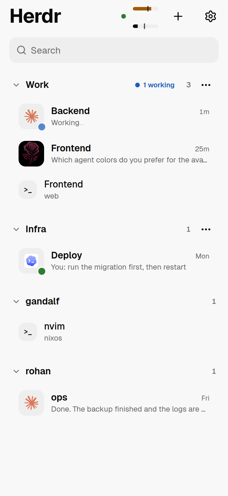</picture> <picture><source media="(prefers-color-scheme: dark)" srcset="docs/screenshots/chat-dark.png">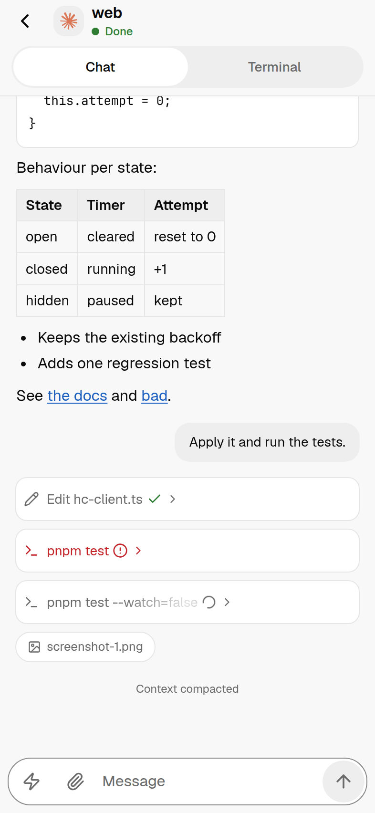</picture> <picture><source media="(prefers-color-scheme: dark)" srcset="docs/screenshots/question-dark.png">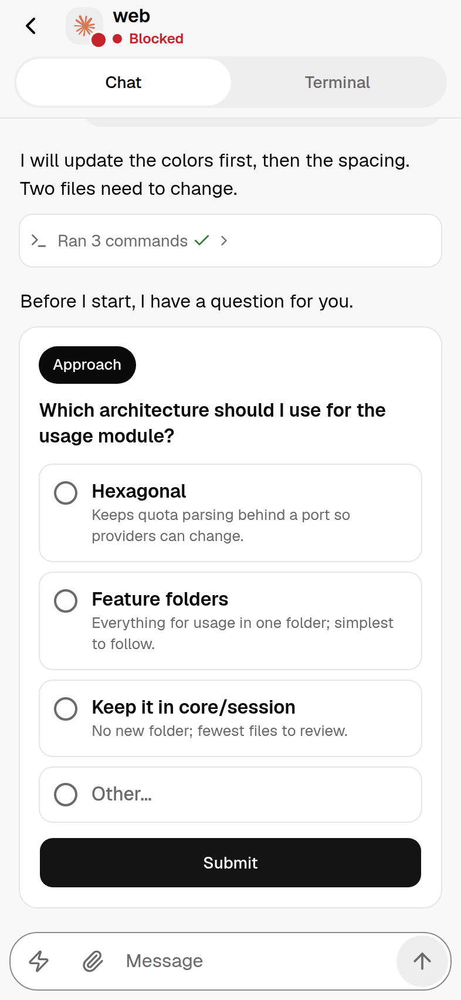</picture> <picture><source media="(prefers-color-scheme: dark)" srcset="docs/screenshots/terminal-dark.png">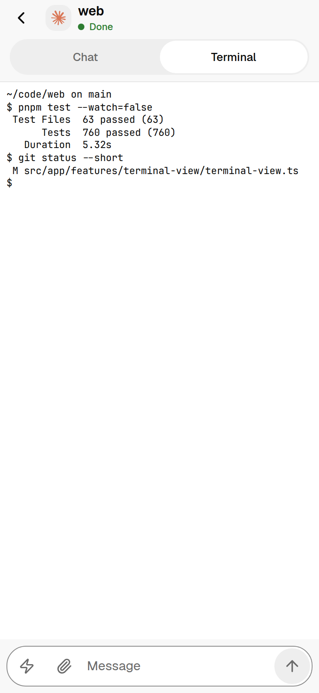</picture>
</p>

## Why

The [herdr](https://github.com/herdrdev/herdr-core) desktop app is a native window and does not
run on a phone. This project is a small Go server plus an installable web app (PWA) that you
reach over [Tailscale](https://tailscale.com), so the terminals and coding agents running on your
Linux machine are one tap away from your pocket. It is a client for machines that already run
herdr-core (`hc`); it does not replace the desktop app. The web app lives in
[spacee-herdr-frontend](https://github.com/spacecodee/spacee-herdr-frontend) and is embedded in
this binary.

## Features

**Terminals**
- Terminals grouped as Space > Tab > terminal, in the same order as the desktop app, live.
- Full terminal with output, input, resize, a mobile key bar (Esc, Tab, Ctrl, arrows) and automatic reconnect when the phone suspends the tab.
- Create, rename, move, split and close spaces, tabs and panes, even with the desktop window closed.

**Chat with agents**
- Agent terminals open as a chat: Claude Code, pi, Codex and opencode transcripts, read-only, with Terminal mode one tap away.
- A conversations list with titles, last message and a "needs attention" strip.
- Attach or paste images from the phone; agents read them from the host.

**Answer questions and permissions**
- Agent questions and permission prompts show up as buttons; answer from the phone.

**Changes and files**
- See the uncommitted changes of a project, open a diff, and read a file read-only with line numbers.

**Usage and stats**
- How much of your agent plan limits you have used, and your own delivery numbers.

**Push**
- Web Push when an agent is blocked or done, or a terminal finishes. No terminal output is ever included.

**Access**
- Token login, paired devices with their own revocable sessions, Origin checks on every upgrade and write.

## Screenshots

| | | | |
| --- | --- | --- | --- |
| <picture><source media="(prefers-color-scheme: dark)" srcset="docs/screenshots/home-dark.png"></picture><br>Home | <picture><source media="(prefers-color-scheme: dark)" srcset="docs/screenshots/chat-dark.png"></picture><br>Chat | <picture><source media="(prefers-color-scheme: dark)" srcset="docs/screenshots/question-dark.png"></picture><br>Agent question | <picture><source media="(prefers-color-scheme: dark)" srcset="docs/screenshots/permission-dark.png">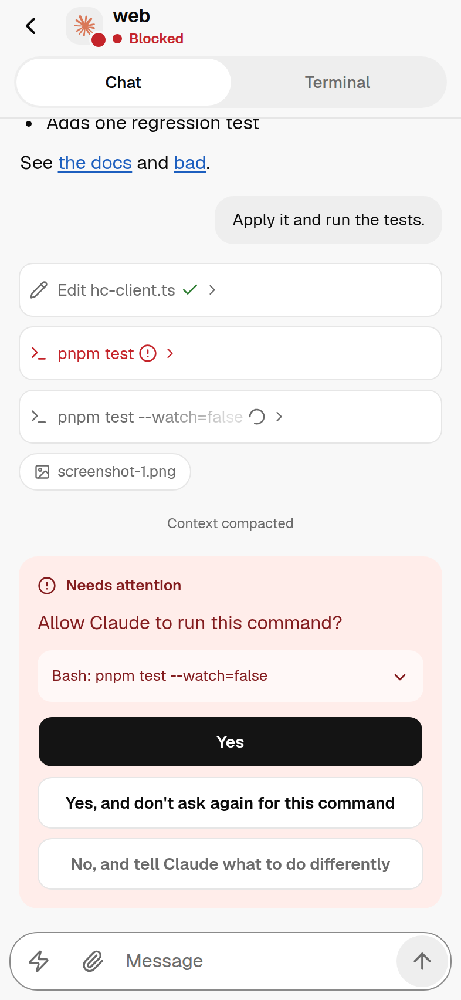</picture><br>Permission prompt |
| <picture><source media="(prefers-color-scheme: dark)" srcset="docs/screenshots/terminal-dark.png"></picture><br>Terminal | <picture><source media="(prefers-color-scheme: dark)" srcset="docs/screenshots/changes-dark.png">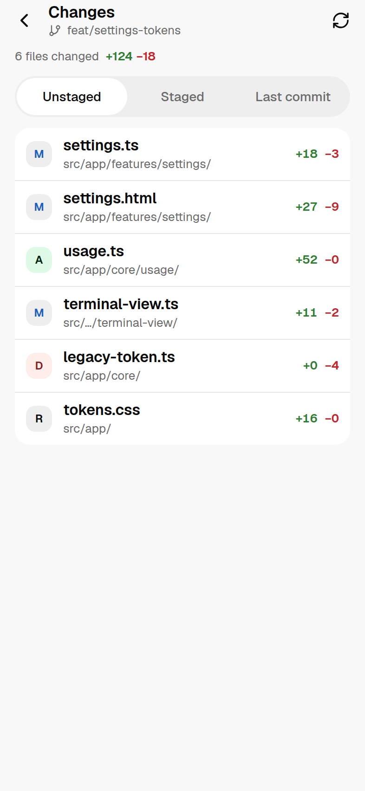</picture><br>Changes | <picture><source media="(prefers-color-scheme: dark)" srcset="docs/screenshots/diff-dark.png">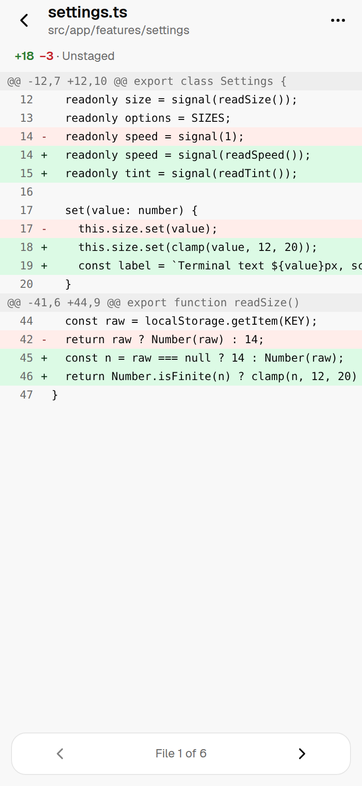</picture><br>Diff | <picture><source media="(prefers-color-scheme: dark)" srcset="docs/screenshots/file-dark.png">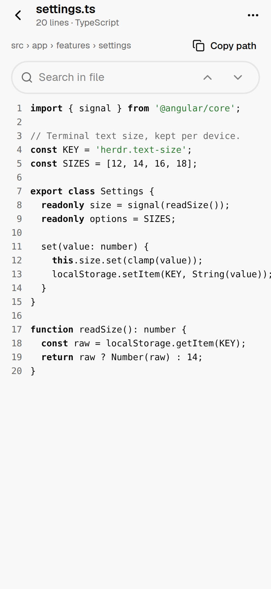</picture><br>File viewer |
| <picture><source media="(prefers-color-scheme: dark)" srcset="docs/screenshots/usage-dark.png">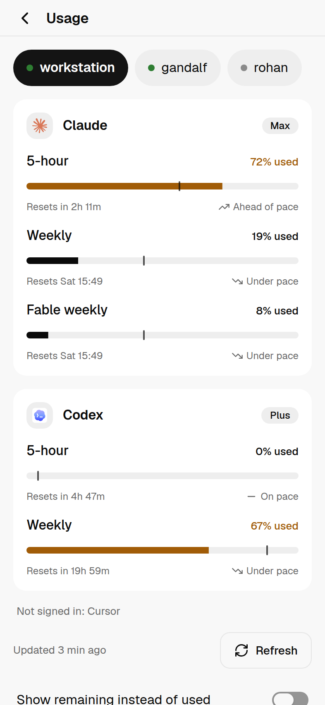</picture><br>Usage | <picture><source media="(prefers-color-scheme: dark)" srcset="docs/screenshots/stats-dark.png">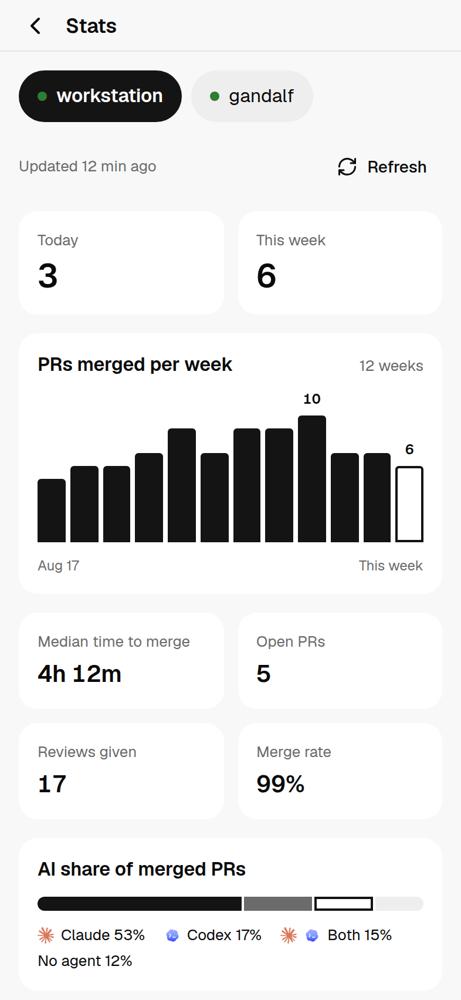</picture><br>Stats | <picture><source media="(prefers-color-scheme: dark)" srcset="docs/screenshots/settings-dark.png">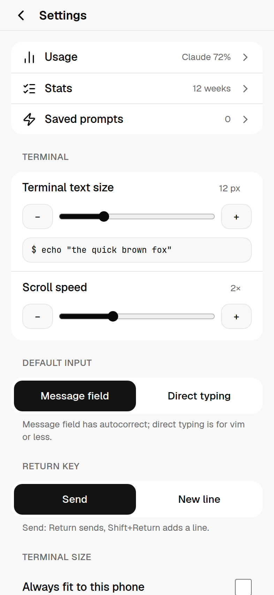</picture><br>Settings |  |

## Architecture

```
phone (installed PWA)
   |  https / wss, tailnet only (tailscale serve)
   v
spacee-herdr-bridge  (this repo, Docker, 127.0.0.1:8080)
   |  Unix socket
   v
herdr-core (hc)  ---- ssh ---->  other machines added with `hc machine add`
```

The bridge has almost no logic: it relays bytes between a WebSocket and core's socket, checks
the session, serves the embedded web app, and adds the few host features a browser cannot do
(transcripts, uploads, push, layout edits).

## Requirements

- Linux host running herdr-core (`hc`) as your user, with lingering enabled.
- Docker Engine with the Compose plugin.
- Tailscale, logged in, with HTTPS certificates enabled for the tailnet.

## Quick start

```sh
git clone https://github.com/spacecodee/spacee-herdr-bridge.git
cd spacee-herdr-bridge
install -d -m 700 ~/.config/spacee-herdr ~/.cache/spacee-herdr/uploads
docker compose pull && docker compose up -d   # prebuilt image from ghcr.io; or: docker compose up -d --build
tailscale serve --bg 8080
```

Pin a version with `BRIDGE_VERSION=1.2.0 docker compose up -d` (default `latest`).

Open `https://<host>.<tailnet>.ts.net` on the phone, sign in with the token from
`~/.config/spacee-herdr/token`, then use Share > Add to Home Screen.

The complete setup (tailnet policy, verification, token rotation, troubleshooting) is in
[docs/host-setup.md](docs/host-setup.md).

## Security model

herdr-core has no authentication: whoever reaches its socket has a shell. The bridge exists to
keep that set of people at one.

- The container publishes only on host loopback. The only way in is `tailscale serve`
  (tailnet only, never Funnel), and the tailnet policy keeps tagged machines out.
- Every API route requires the session cookie; writes and upgrades also require a same-origin
  request.
- Tokens, terminal data, transcripts and upload paths are never logged.
- The container runs as your user, not root. It mounts the agent directories read-only and
  uses `pid: host` only to see which agent runs in each terminal; this adds visibility, not
  privilege, since it already holds a shell-equivalent socket.
- Layout and agent launches accept only an allow-listed set of programs; closing anything
  requires an explicit confirmation flag.

See [SECURITY.md](SECURITY.md) for the threat model and how to report a vulnerability. Never
expose the bridge on the public internet.

## Configuration

Flags (Compose sets the ones that differ from the defaults):

| Flag | Default | Purpose |
| --- | --- | --- |
| `-listen` | `127.0.0.1:8080` | Listen address. Keep it on loopback. |
| `-core` | `/run/user/<uid>/herdr-core/default.sock` | herdr-core socket. |
| `-upload-dir` | `~/.cache/spacee-herdr/uploads` | Uploaded images; must be a host path. |
| `-home` | your home | Where `.claude`, `.pi` and `.codex` live. |
| `-proc` | `/proc` | Process table used to identify agents. |
| `-push-subject` | repository URL | VAPID subject for Web Push. |

Files in `~/.config/spacee-herdr` (all mode 0600): `token`, `vapid.json`, `push.json`.

## API

All routes require the session cookie.

| Route | Description |
| --- | --- |
| `POST /api/session`, `GET /api/session` | Sign in with the token; check the session. |
| `GET /ws` | WebSocket relayed to herdr-core. |
| `GET /api/chat?terminal=<address>` | SSE stream of an agent conversation (`reset`, `append`, `update`, `remove`, `none`). An agent that has not written its transcript yet (before its first message) gets an empty `reset` with its agent name. |
| `GET /api/chat/summaries` | Title and last message of every agent terminal; an agent before its first message is listed with `messages: 0` and no `last`. |
| `GET /api/push/key`, `POST`/`DELETE /api/push/subscription`, `POST /api/push/test` | Web Push. |
| `POST /api/upload` | Store an image (PNG, JPEG, WebP, GIF, at most 15 MiB). |
| `/api/layout/...` | Spaces, tabs and panes: create, split, rename, move, close. |
| `GET /healthz` | Liveness, no authentication. |

## Development

```sh
go vet ./... && go test -race ./...
go build -o bin/bridge ./cmd/bridge
```

Tests use a fake herdr-core on a temporary Unix socket, never your real one.

To ship a new web app build, build the frontend and copy it into the embedded directory:

```sh
(cd ../spacee-herdr-frontend && pnpm build)
rm -rf internal/webui/dist/* && cp -R ../spacee-herdr-frontend/dist/spacee-herdr-frontend/browser/. internal/webui/dist/
scripts/deploy.sh   # docker compose up -d --build with the git version, then checks /healthz
```

## Build and release

Everything runs locally; there is no CI.

```sh
scripts/build.sh [--skip-tests]   # frontend build + embed + checks + binaries in bin/release/ + local Docker image
scripts/release.sh 1.3.0          # changelogs, version, build, commit and tag in both repos (never pushes)
scripts/release.sh --dry-run 1.3.0
scripts/release.sh --push-image 1.3.0   # multi-arch image to ghcr.io, built from tag v1.3.0
```

### Publishing the image (maintainers)

Create a classic token at GitHub → Settings → Developer settings → Personal access tokens (classic), with only `write:packages` and a short expiry. `--push-image` asks for the token without echo (user from `GHCR_USER` or `gh`), logs in, builds from the
release tag in a temporary worktree, pushes, and runs `docker logout ghcr.io` when it ends, so the token does not
stay in `~/.docker/config.json`. Without a terminal it stops and prints the manual `docker login` command. Never mount `~/.docker` into a container. After the first push, make the
package public once: GitHub → Packages → spacee-herdr-bridge → Package settings → Change visibility.

`release.sh` stops unless both repos are clean on `main`, the version is new semver, and both changelogs have entries under `[Unreleased]`. It prints the `git push` commands for you to run. The frontend is read from `../spacee-herdr-frontend` (override with `FRONTEND_DIR`). `bridge -version` prints the build version.

## Contributing

See [CONTRIBUTING.md](CONTRIBUTING.md). Release notes are in [CHANGELOG.md](CHANGELOG.md).

## License

[MIT](LICENSE)
